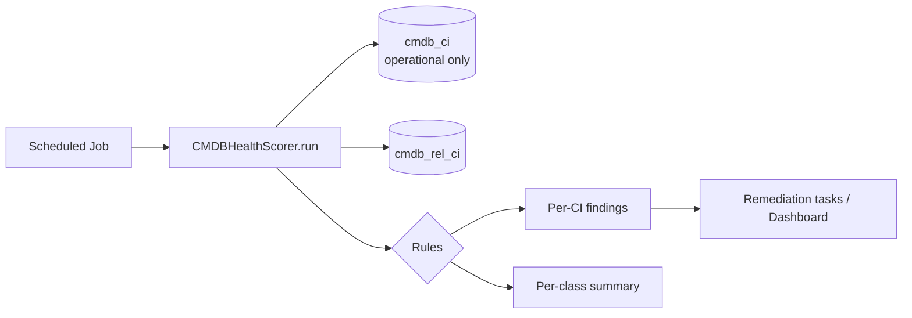

# ServiceNow CMDB Health Toolkit


> **Portfolio project.** This is independently written demonstration code that uses synthetic data. It is not taken from, and does not represent, any employer's or client's production code.

A server-side Script Include that scores Configuration Items on **completeness, correctness, and compliance**, the same three dimensions used by the ServiceNow CMDB Health Dashboard. It returns a per-CI and per-class report that a Scheduled Job, dashboard, or remediation flow can consume.

## The business problem

When a CMDB has duplicates, orphaned application CIs, and stale records, Change risk assessment, Incident impact analysis, and Discovery reconciliation all become unreliable. Platform teams need a repeatable, explainable health check they can tune for each CI class and run on a schedule. That check should not depend only on out-of-box dashboards.

## What it checks

| Dimension | Rule | Issue type |
|---|---|---|
| Completeness | Required attributes for each class are populated (configurable) | `missing_fields` |
| Correctness | Duplicate serial number (case and whitespace insensitive), or the same normalised name within a class | `duplicate` |
| Correctness | Application and service CIs have at least one relationship | `orphan` |
| Compliance | Last discovered within *N* days (default 30) | `stale` |
| Compliance | CI has a support group or owner (CSDM ownership) | `no_ownership` |

The score is a weighted blend (40 / 35 / 25 by default) from 0 to 100.



## Sample output (synthetic data)

```
$ npm run report
CIs evaluated: 7 | healthy: 4 | issues: 10 | avg score: 80

CI                  Class             Score  Issues
web-prd-01          server            100    -
web-prd-02          server            100    -
WEB-PRD-01          server            46     missing_fields, duplicate, stale, no_ownership
db-prd-01           server            80     missing_fields, stale
Order Portal        appl              100    -
Legacy Reporting    appl              31     missing_fields, orphan, stale, no_ownership
Online Ordering     service           100    -
```

## Tech stack

ServiceNow Script Include (ES5, Glide API), GlideRecord, CSDM conventions, and Node.js 18+ built-in test runner with a lightweight Glide mock. GitHub Actions runs CI on Node 20 and 22.

## Repository layout

```
src/CMDBHealthScorer.js     Script Include (paste into an instance)
config.example.json         Rules: required fields, stale days, weights
data/sample-cmdb.json       Synthetic CIs and relationships
test/glide-mock.js          Minimal in-memory GlideRecord/gs for unit tests
test/cmdb-health.test.js    8 unit tests
scripts/run-report.js       Prints the sample report above
```

## Run locally

```bash
git clone https://github.com/pedapatisrujana-a11y/servicenow-cmdb-health-toolkit.git
cd servicenow-cmdb-health-toolkit
npm test          # no dependencies to install
npm run report
```

## Install in a ServiceNow instance (PDI recommended)

1. **System Definition > Script Includes > New**: Name `CMDBHealthScorer`. Paste `src/CMDBHealthScorer.js`.
2. Create a **Scheduled Script Execution**:
   ```javascript
   var report = new CMDBHealthScorer({ staleDays: 30 }).run();
   gs.info(JSON.stringify(report.totals));
   ```
3. Optional: write `report.findings` to a custom table and add a dashboard, or open remediation tasks for scores below a threshold.

## Error handling and security

- The scorer only reads data and never updates CIs.
- Missing or unparseable dates are treated as "never discovered" instead of throwing an error.
- No credentials or instance URLs are used. See [SECURITY.md](SECURITY.md).

## Limitations and next steps

- Relationship counts are loaded in a single pass. For very large CMDBs, use `GlideAggregate` and run the check per class.
- Duplicate rules are intentionally simple. Production instances should rely on IRE identification rules.
- Planned additions: Performance Analytics indicator source, a `GlideAggregate` version, and remediation task creation through Flow Designer.

## License

MIT. See [LICENSE](LICENSE).
